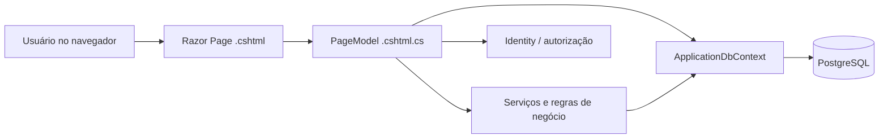

# Churras da Galera (CdG)

**Aplicação web para organizar eventos entre amigos, gerenciar participantes e dividir despesas.**

O Churras da Galera nasceu como um projeto acadêmico de Análise de Sistemas e evoluiu para uma aplicação em **ASP.NET Core Razor Pages**, com autenticação, persistência em PostgreSQL e regras de organização e acerto financeiro. Este repositório reúne a implementação, os testes e a documentação de estudo e apresentação.

> **Estado da versão:** executada localmente com .NET 10 e PostgreSQL; compilação, cadastro/login e criação/edição/consulta de eventos foram verificados no ambiente do desenvolvedor. Há testes automatizados para regras financeiras, mas os fluxos completos com múltiplas contas, concorrência em PostgreSQL, SMTP e hospedagem pública ainda exigem validação. Não há uma instância pública disponível neste momento.

## O que o projeto faz

- **Conta e acesso:** cadastro, login e atualização de dados por ASP.NET Core Identity.
- **Eventos:** criação com data, horário, local e limite de pessoas; edição, adiamento, cancelamento e conclusão.
- **Organização:** convites por e-mail de usuários cadastrados, confirmação/recusa, lotação e promoção de participantes a organizadores.
- **Participação:** saída do evento, sucessão de organizador e histórico individual com ocultação/restauração.
- **Notificações internas:** convites e alterações relevantes do evento.
- **Financeiro:** registro e anulação de despesas, rateio igual entre confirmados, fechamento de cotas, pagamentos informados manualmente, confirmação pelo recebedor e renúncia ao crédito restante.

**Importante:** o sistema **não processa pagamentos**, apenas registra despesas e confirmações de transferências feitas fora da plataforma. O papel de criador fica armazenado, mas **não existe**, nesta versão, uma função exclusiva de cancelamento reservada ao criador.

## Tecnologias

| Camada | Tecnologia |
| --- | --- |
| Linguagem | C# |
| Aplicação web | .NET 10, ASP.NET Core Razor Pages |
| Dados | Entity Framework Core 10, Npgsql, PostgreSQL |
| Identidade | ASP.NET Core Identity |
| Interface | Razor, HTML, CSS, Bootstrap, JavaScript |
| Desenvolvimento | Visual Studio, SDK .NET, Git |

## Arquitetura em uma visão



A pasta `CdG/Pages` contém as telas e seus handlers; `CdG/Models` representa os dados; `CdG/Services` concentra regras compartilhadas; `CdG/Data` define o contexto e os relacionamentos; `CdG/Migrations` versiona a estrutura do banco.

## Instalação local rápida

**Requisitos:** SDK .NET 10, PostgreSQL e, opcionalmente, Visual Studio com suporte a ASP.NET Core. Os comandos abaixo são executados a partir da **raiz do repositório** (onde está `CdG.slnx`).

1. Crie um banco PostgreSQL separado, por exemplo `cdg_v1_teste`.
2. Configure o acesso ao banco com **Gerenciar Segredos de Usuário** no projeto `CdG` (ou via variável de ambiente). O arquivo de segredos **não** deve entrar no Git:

   ```json
   {
     "ConnectionStrings": {
       "DefaultConnection": "Host=localhost;Port=5432;Database=cdg_v1_teste;Username=postgres;Password=SUA_SENHA"
     }
   }
   ```

3. Restaure, compile e aplique as migrations **somente depois de conferir o nome do banco**:

   ```powershell
   dotnet restore CdG/CdG.csproj
   dotnet build CdG/CdG.csproj
   dotnet run --project CdG/CdG.csproj -- --migrate
   ```

4. Execute a aplicação:

   ```powershell
   dotnet run --project CdG/CdG.csproj --launch-profile https
   ```

   No perfil atual, o endereço de desenvolvimento é `https://localhost:7103`. Em ambiente de desenvolvimento o projeto permite cadastro sem confirmação por e-mail; fora dele a confirmação exige SMTP corretamente configurado.

Para instruções completas e alertas sobre banco antigo, veja [Guia de instalação](docs/INSTALACAO.md).

## Exemplo: divisão das despesas

Em um evento com três pessoas confirmadas:

| Pessoa | Quanto gastou | Cota igual | Saldo inicial |
| --- | ---: | ---: | ---: |
| A | R$ 100,00 | R$ 40,00 | + R$ 60,00 |
| B | R$ 20,00 | R$ 40,00 | − R$ 20,00 |
| C | R$ 0,00 | R$ 40,00 | − R$ 40,00 |

Depois de concluir ou cancelar o evento, um organizador fecha o rateio. Os valores ficam fixados em centavos. B e C podem informar pagamentos a A; o saldo só é atualizado quando A confirma o recebimento. Um crédito pode ser renunciado integralmente, de forma definitiva, sem transferência bancária.

## Organização e documentação

```text
CdG.slnx
CdG/
  Areas/Identity/      # Páginas de conta
  Data/                # ApplicationDbContext
  Migrations/          # Evolução do schema
  Models/              # Entidades e enums
  Pages/               # Razor Pages e handlers
  Services/            # Participação, notificações e financeiro
  ViewComponents/      # Menu de notificações
  wwwroot/             # CSS, JavaScript e Bootstrap
tests/CdG.Verificacao/  # Verificações executáveis do financeiro
docs/                  # Tutoriais, testes, diagramas históricos
```

| Documento | Para quem e para quê |
| --- | --- |
| [Guia de estudo do código](docs/GUIA_DE_ESTUDO.md) | Aprender como cada parte funciona e praticar pequenas alterações. |
| [Guia de apresentação](docs/GUIA_DE_APRESENTACAO.md) | Explicar a solução a professores, colegas e recrutadores. |
| [Instalação detalhada](docs/INSTALACAO.md) | Preparar ambiente, User Secrets e migrations. |
| [Roteiro de testes](docs/TESTES.md) | Validar regras com mais de um usuário e cenários financeiros. |
| [Validação e limites](docs/VALIDACAO.md) | Distinguir testes realizados das verificações ainda pendentes. |
| [Diagramas e documentos anteriores](docs/historico/) | Material acadêmico de apoio; pode não refletir todas as regras financeiras atuais. |

### Testes automatizados

```powershell
dotnet run --project tests/CdG.Verificacao/CdG.Verificacao.csproj
```

Esse executável valida parte do rateio e das operações financeiras com **SQLite em memória**. Não equivale a um teste de concorrência/migrations em PostgreSQL. Os cenários manuais estão em `docs/TESTES.md`.

## Limitações e próximos passos

O rateio é igual entre participantes confirmados; não há rateio por consumo, cobrança automática ou gateway de pagamento. Pagamentos confirmados não possuem estorno e o fechamento do financeiro é definitivo. O cancelamento não quita automaticamente dívidas. A interface completa, acessibilidade, confirmação por e-mail em produção, testes de concorrência com PostgreSQL e implantação externa ainda precisam ser revisados. Para publicação na internet também serão necessários HTTPS, SMTP, proteção das chaves de Data Protection, configuração segura de proxy e backup.
