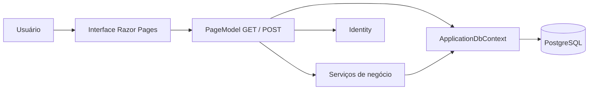
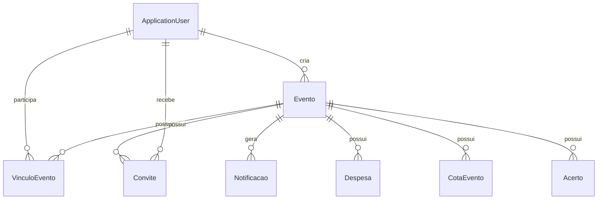

# Guia de apresentação — Churras da Galera

**Público:** professores, banca de extensão, colegas, recrutadores e entrevistadores técnicos. **Propósito:** apresentar com segurança uma aplicação existente, demonstrar a solução, justificar decisões e reconhecer limites. O conteúdo reflete o código desta versão; os diagramas acadêmicos anteriores podem exigir atualização.

## 1. Ficha rápida do projeto

| Pergunta | Resposta objetiva |
| --- | --- |
| O que é? | Uma aplicação web para organizar eventos em grupo, gerenciar convites/presenças e registrar divisão de despesas. |
| Por que foi criada? | Para centralizar a organização que costuma ficar dispersa em mensagens, listas e cálculos manuais. |
| Contexto | Iniciou como trabalho de Análise de Sistemas e evoluiu como projeto prático de Sistemas de Informação. |
| Tecnologias | C#, .NET 10, ASP.NET Core Razor Pages, EF Core, PostgreSQL, Identity, Bootstrap. |
| Usuários | Pessoas cadastradas; cada evento possui organizador(es) e participantes. |
| Principais módulos | Contas, eventos, convites, participação, notificações, financeiro. |
| O que não faz? | Não movimenta dinheiro nem cobra automaticamente; não está validado como serviço público na internet. |
| Estado atual | Aplicação compilada e utilizada localmente; autenticação e eventos básicos testados, financeiro com verificações automatizadas e roteiro de testes completos ainda a executar. |

## 2. Roteiro sugerido de 5 minutos

**0:00–0:45 — Problema.** “Em encontros entre amigos, as informações sobre data, local, participantes e quem pagou cada despesa acabam em lugares diferentes. O CdG tenta reunir essas etapas em uma única aplicação.”

**0:45–1:30 — Visão geral.** Mostre a página inicial e explique que cada usuário possui uma conta, pode criar eventos, receber convites e acompanhar seus próprios eventos. Diga que o sistema foi construído com Razor Pages e PostgreSQL.

**1:30–2:45 — Fluxo de organização.** Entre com a conta A, mostre um evento de demonstração, o formulário de convite e a lista de confirmados. Explique o limite de vagas, a possibilidade de promover participantes a organizadores e as notificações internas.

**2:45–4:10 — Financeiro.** Mostre um **evento demonstrativo separado, concluído ou cancelado, com rateio já fechado**, três participantes fictícios e valores conhecidos: A pagou R$ 100, B pagou R$ 20, C pagou R$ 0. Mostre cotas de R$ 40 e saldos +60/−20/−40. Explique que um pagamento fica pendente até o recebedor confirmar.

**4:10–5:00 — Tecnologia, estado atual e evolução.** Abra rapidamente a organização de pastas, explique a separação `Pages` → `Services` → `DbContext` e mostre um teste. Termine com limitações reais: pagamentos manuais, testes de concorrência em PostgreSQL e implantação externa ainda pendentes.

> Não espere o horário de um evento durante a apresentação. Prepare **antes** um evento encerrado com dados fictícios e outro evento ativo para demonstrar o fluxo de convites, sem alterar o banco principal.

## 3. Roteiro técnico de 10 a 15 minutos

1. **Problema e requisitos (2 min):** objetivo, escopo e regras (não aceitar além da capacidade, quem organiza, como ratear).
2. **Demonstração (4 min):** evento, convites, participação e financeiro com contas fictícias.
3. **Arquitetura (3 min):** navegação entre `.cshtml`, `.cshtml.cs`, serviços e PostgreSQL. Mostre `Program.cs` e `ApplicationDbContext.cs`.
4. **Modelo de dados (2 min):** `Evento`, `ApplicationUser`, `VinculoEvento`, `Convite`, `Despesa`, `CotaEvento`, `Acerto`.
5. **Qualidade e decisões (2 min):** validações do servidor, Identity, transações, valores em centavos e testes automatizados.
6. **Limitações e próximos passos (1–2 min):** concorrência real, e-mail em produção, hospedagem, melhorias de UX e documentação atualizada.

## 4. Demonstração prática com segurança

### Preparação

- Use **PostgreSQL de testes**, não o banco anterior; verifique `SELECT current_database();`.
- Tenha três contas **fictícias** A, B e C cadastradas. Não exponha senha nem e-mail pessoal na tela.
- Separe um evento ativo para convites e outro encerrado com gastos e financeiro fechado.
- Abra duas sessões diferentes (navegador normal e anônimo/perfis) para representar pessoas distintas.
- Antes de apresentar, valide o roteiro `docs/TESTES.md`, pelo menos os passos usados na demonstração.
- Tenha capturas de tela como plano B caso o banco ou a internet falhe; não exiba dados reais.

### História que o público acompanhará

1. **A cria um evento**: informar data futura, local e capacidade. O autor entra como organizador com presença confirmada.
2. **A convida B e C**: o sistema busca usuários cadastrados por e-mail e registra convites.
3. **B e C respondem**: a presença e o controle de capacidade são atualizados, e os avisos ficam na área de notificações.
4. **Despesas de um evento já encerrado**: A registra R$ 100 e B R$ 20 (ou mostre registros previamente criados).
5. **Fechamento**: um organizador fixa o rateio entre os confirmados.
6. **Acerto externo**: B informa um pagamento de R$ 20 a A; explique que a dívida não desaparece antes da confirmação de A.
7. **Após a confirmação**: mostre o saldo atualizado. Se a demonstração incluir renúncia, avise que a operação é definitiva e use outro evento descartável.

**Duas cautelas importantes:** o sistema não permite fechar o rateio de um evento ainda ativo; e um evento cancelado pode continuar tendo obrigações financeiras. Não descreva “cancelamento com reembolso automático”, pois isso não existe aqui.

## 5. Arquitetura para explicar no quadro

**Fala de apoio:** “A interface mostra campos e resultados, mas não toma decisões de segurança sozinha. O `PageModel` recebe as requisições e valida acesso. As regras compartilhadas ficam em serviços, como o financeiro. O Entity Framework Core persiste os objetos no PostgreSQL. O Identity fornece contas e autenticação.”

### Mini-diagrama de relações

O diagrama acima é **simplificado** para apresentação. O `ApplicationDbContext.cs` define outros relacionamentos, inclusive usuários ligados a despesas, cotas, acertos e notificações. Não o chame de diagrama físico completo.

## 6. Decisões técnicas que valem destaque

| Decisão | Por que adotada | Ressalva honesta |
| --- | --- | --- |
| Razor Pages | Mantém interface e tratamento de requisições próximos, adequado ao escopo atual. | Uma evolução para API/app móvel exigirá novos endpoints ou arquitetura. |
| PostgreSQL + EF Core | Persistência relacional, migrações e consultas tipadas. | É preciso testar migrations e concorrência no PostgreSQL real. |
| Identity | Evita implementar autenticação e hash de senhas manualmente. | Produção exige confirmação de conta, SMTP e configuração segura. |
| `VinculoEvento` | Guarda papel, presença e histórico de cada pessoa por evento. | Não é apenas uma lista simples de usuários. |
| Centavos como `long` | Evita diferenças de arredondamento na divisão das despesas. | A interface ainda deve validar entrada e formatação. |
| Transações e `FOR UPDATE` | Reduz conflitos nas alterações concorrentes de um mesmo evento. | Os testes locais automatizados não comprovam comportamento simultâneo no PostgreSQL. |
| Confirmação pelo recebedor | Separa “informei pagamento” de “recebi pagamento”. | Não comprova transferência bancária real. |

## 7. Perguntas prováveis de professores e recrutadores

**1. Por que criar o CdG?** Para reunir informações dispersas de organização de encontros, especialmente presença, convites e divisão de custos, em um sistema que possa evoluir por requisitos.

**2. Qual a diferença entre `Model` e `PageModel`?** `Model` descreve entidades/dados persistentes; `PageModel` recebe a requisição e prepara ou altera dados para uma página Razor.

**3. Por que usar EF Core em vez de escrever todo o SQL?** Ele ajuda a mapear classes para tabelas, consultar por LINQ e controlar migrations; SQL ainda aparece em pontos específicos, como bloqueio de linha.

**4. Como os dados ficam separados entre usuários?** O servidor usa a identidade autenticada e verifica vínculos/permissões do evento; não basta esconder botões.

**5. Como funciona a última vaga?** O servidor verifica as presenças confirmadas dentro de um fluxo com transação e bloqueio da linha do evento, de modo a diminuir conflitos; a garantia em concorrência real precisa de validação no PostgreSQL.

**6. Quem é o criador e quem pode organizar?** `Evento.CriadorId` registra quem criou. Permissões de organização atualmente dependem de `VinculoEvento.Papel == Organizador`. Não existe exclusividade de cancelamento do criador.

**7. Como o rateio lida com R$ 10 para três pessoas?** Divide 1000 centavos, produzindo cotas de 334, 333 e 333 centavos em ordem estável, sem perder centavos.

**8. O aplicativo transfere dinheiro?** Não. Ele contabiliza despesas e registros de acerto. O pagamento é realizado fora do CdG e confirmado na aplicação pelo recebedor.

**9. É possível desfazer um acerto confirmado?** Não nesta versão; um acerto pendente pode ser cancelado, mas a confirmação é definitiva pelo fluxo atual.

**10. O evento pode ser cancelado e ainda haver dívida?** Sim. Estado do evento e quitação financeira são separados; gastos efetivos podem precisar de rateio mesmo após cancelamento.

**11. Você fez testes?** A aplicação foi compilada e testada localmente nos fluxos básicos reportados. Há verificações automatizadas do financeiro com SQLite em memória; a cobertura de navegação completa, concorrência no PostgreSQL, SMTP e produção ainda está em evolução.

**12. O que faria na próxima versão?** Testes de integração PostgreSQL, melhorias nas regras financeiras/estornos, UX, documentação de diagramas atualizados e implantação controlada, com segurança e monitoramento.

**13. O código foi desenvolvido com auxílio de ferramentas?** Responda conforme sua participação real: explique as ferramentas que utilizou, o que você revisou e testou, e quais decisões entende. É mais importante demonstrar domínio técnico do que atribuir a si tarefas que não realizou sozinho.

## 8. O que mostrar no Visual Studio, sem ler tudo

Abra estas abas antes da apresentação:

1. `CdG/Program.cs` — configuração do banco, Identity e serviços.
2. `CdG/Models/Evento.cs` — dados e estados do evento.
3. `CdG/Models/VinculoEvento.cs` — participação e papel do usuário.
4. `CdG/Data/ApplicationDbContext.cs` — tabelas e relacionamentos.
5. `CdG/Pages/Eventos/Criar.cshtml.cs` — exemplo simples de GET/POST e `SaveChangesAsync`.
6. `CdG/Services/FinanceiroService.cs` — regras financeiras e transação.
7. `CdG/Services/CalculoRateio.cs` — algoritmo curto de centavos.
8. `tests/CdG.Verificacao/Program.cs` — verificações executáveis.

Em vez de ler código linha por linha, use a estrutura **entrada → validação → regra → gravação → resultado**.

## 9. Diagramas e trabalho acadêmico

O repositório inclui documentos e diagramas anteriores em `docs/historico/` (casos de uso, classes, DFD e materiais da disciplina). Eles são **referência da evolução do projeto**, não prova de que cada detalhe do desenho corresponde à versão financeira mais nova.

Para o trabalho de extensão, antes de imprimir ou apresentar documentação formal, confira com o professor se são exigidos objetivo, justificativa, requisitos funcionais/não funcionais, modelagem, evidências de testes, resultados e impacto da extensão. Não invente esses requisitos sem o enunciado.

## 10. Checklist no dia da apresentação

- [ ] Aplicação abre, banco correto e dados fictícios estão disponíveis.
- [ ] Ao menos duas contas conseguem efetuar login em sessões diferentes.
- [ ] Evento de demonstração já tem convites/presenças prontos.
- [ ] Evento financeiro de demonstração já foi encerrado e fechado.
- [ ] As telas e os arquivos citados neste guia foram abertos e reconhecidos.
- [ ] Nenhuma senha ou e-mail pessoal fica à mostra.
- [ ] Tenho uma captura das telas como alternativa se houver falha de execução.
- [ ] Consigo explicar três decisões técnicas sem ler slides.
- [ ] Consigo apontar pelo menos uma limitação e uma melhoria futura.

**Mensagem de encerramento sugerida:** “O CdG me permitiu sair da modelagem acadêmica e trabalhar em uma aplicação funcional, com autenticação, persistência, permissões e regras financeiras. O objetivo da próxima etapa é ampliar os testes e preparar uma implantação segura, mantendo o projeto documentado e evoluindo a partir do que já está implementado.”
