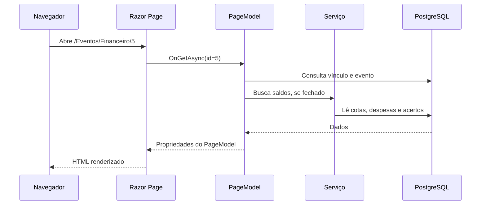
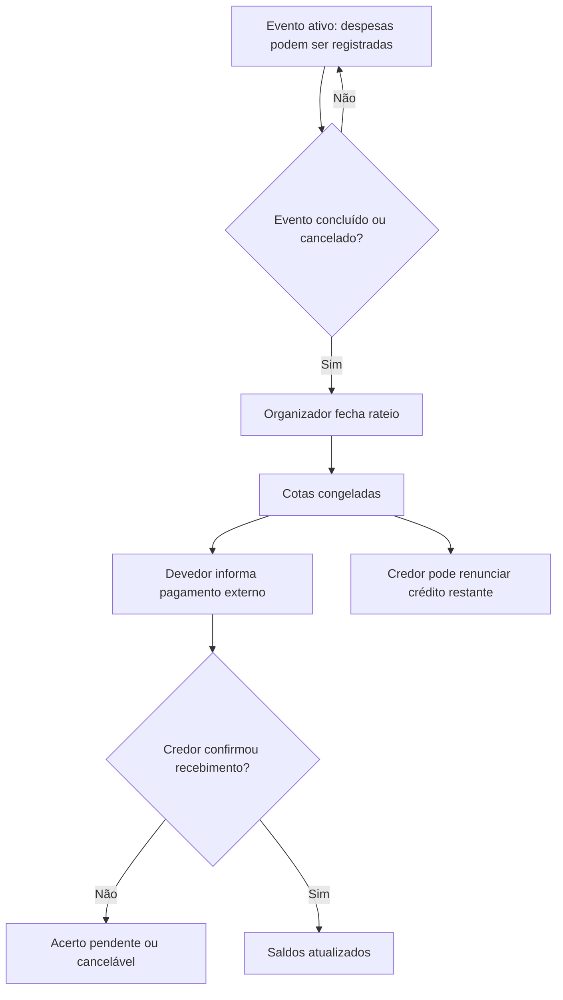

# Guia de estudo — entendendo o código do Churras da Galera

**Objetivo:** entender a aplicação que você está mantendo, conseguir seguir uma requisição do navegador até o banco, testar uma regra e modificá-la com segurança. Este texto foi organizado a partir dos arquivos da versão CdG v1 integrada; não é um tutorial genérico para um projeto criado do zero.

**Como estudar:** abra `CdG.slnx` no Visual Studio e mantenha este guia ao lado. Siga a sequência dos capítulos e localize **os arquivos reais** antes de executar cada exercício. Faça alterações somente em um branch de estudo ou numa cópia, nunca diretamente na única versão que está funcionando.

## 0. Mapa de leitura (sugestão de cinco encontros)

| Sessão | Assunto | Arquivos para abrir | Resultado esperado |
| --- | --- | --- | --- |
| 1 | Inicialização e Razor Pages | `Program.cs`, `Pages/Index.cshtml`, `Pages/Index.cshtml.cs` | Saber como a página chega ao navegador. |
| 2 | Dados e Identity | `Data/ApplicationDbContext.cs`, `Models/*.cs`, `Areas/Identity/` | Entender entidades, chaves e usuários. |
| 3 | Eventos e participação | `Pages/Eventos/*.cshtml.cs`, `Services/ParticipacaoService.cs` | Seguir criação, convite, confirmação e saída. |
| 4 | Financeiro | `Models/Financeiro.cs`, `Pages/Eventos/Financeiro*`, `Services/FinanceiroService.cs` | Explicar a fórmula do rateio e os acertos. |
| 5 | Segurança, migrations e Git | `Migrations/`, `tests/`, `docs/` | Testar, depurar e apresentar alterações. |

## 1. O que é cada tecnologia

- **C#**: linguagem em que as regras do servidor foram escritas. As classes `Evento`, `VinculoEvento` e `FinanceiroService` são C#.
- **.NET 10**: plataforma/SDK que compila e executa esse código.
- **ASP.NET Core**: infraestrutura web que recebe requisições HTTP, gerencia usuários, valida acesso e devolve páginas.
- **Razor Pages**: uma tela normalmente possui um arquivo `.cshtml` (HTML + sintaxe Razor) e outro `.cshtml.cs` (classe `PageModel`, com dados e ações). É o padrão predominante do CdG; não é uma aplicação React ou uma API REST separada.
- **Entity Framework Core (EF Core)**: traduz consultas de objetos C# em SQL e registra alterações no banco.
- **Npgsql**: provedor que permite ao EF Core trabalhar com PostgreSQL.
- **PostgreSQL**: guarda permanentemente usuários, eventos, vínculos, convites, notificações e acertos.
- **Identity**: mecanismo de cadastro, login, cookies de autenticação e armazenamento protegido de senhas.
- **Bootstrap**: auxilia no layout responsivo das telas.

### Fluxo de uma requisição



O diagrama mostra os componentes envolvidos; na prática, o `PageModel` e o serviço usam o mesmo `ApplicationDbContext` associado à requisição.

## 2. Conhecendo a estrutura real do projeto

> Todos os caminhos abaixo partem da pasta `CdG/` **interna** ao repositório, a que contém `CdG.csproj` e `Program.cs`.

| Caminho | Para que serve | Arquivo de referência |
| --- | --- | --- |
| `Program.cs` | Configura serviços, middleware, Identity e acesso ao banco | `Program.cs` |
| `Models/` | Entidades do domínio e enums (estados possíveis) | `Models/Evento.cs`, `Models/VinculoEvento.cs`, `Models/Financeiro.cs` |
| `Data/` | Mapeamento das entidades e integridade | `Data/ApplicationDbContext.cs` |
| `Migrations/` | Histórico da evolução estrutural do banco | `20261018123556_AdicionarFinanceiro.cs` |
| `Pages/` | Páginas e ações HTTP (GET/POST) | `Pages/Eventos/Detalhes.cshtml.cs` |
| `Services/` | Regras compartilhadas e operações mais complexas | `FinanceiroService.cs`, `ParticipacaoService.cs` |
| `Areas/Identity/` | Cadastro e páginas personalizadas da conta | `Areas/Identity/Pages/Account/Register.cshtml.cs` |
| `ViewComponents/` | Pequenos componentes de interface que carregam dados | `NotificacoesMenuViewComponent.cs` |
| `wwwroot/` | Arquivos estáticos públicos: CSS, JS e bibliotecas | `wwwroot/css/site.css` |
| `tests/CdG.Verificacao/` | Programa separado que verifica regras financeiras | `tests/CdG.Verificacao/Program.cs` (fora da pasta interna) |

**Exercício de reconhecimento:** localize um arquivo `.cshtml` e seu `.cshtml.cs`. Qual dos dois contém o HTML? Onde você encontra `OnGetAsync` e `OnPostAsync`?

## 3. Program.cs: o ponto de partida

Abra `CdG/Program.cs`, nesta ordem:

**3.1 Configuração e injeção de dependências.** `WebApplication.CreateBuilder(args)` prepara o aplicativo e lê configurações. `GetConnectionString("DefaultConnection")` recupera uma conexão configurada fora do código. O projeto registra `ApplicationDbContext` com `UseNpgsql(connectionString)`.

```csharp
var connectionString = builder.Configuration
    .GetConnectionString("DefaultConnection")
    ?? throw new InvalidOperationException(
        "A conexão DefaultConnection não foi configurada.");

builder.Services.AddDbContext<ApplicationDbContext>(options =>
    options.UseNpgsql(connectionString));
```

- **`builder.Configuration`** lê valores combinados de diferentes fontes: JSON, User Secrets no desenvolvimento, variáveis de ambiente etc. Uma fonte de maior prioridade pode substituir outra.
- **`AddDbContext`** registra o contexto para ser solicitado pelos construtores. Você não precisa criar manualmente uma conexão a cada clique.
- **User Secrets** não é um gerenciador de segredos para produção; serve principalmente para desenvolvimento local. O `UserSecretsId` está no `CdG.csproj` e pode ser compartilhado por cópias do mesmo projeto no mesmo PC. Por isso já tivemos cuidado especial com o banco usado nas migrations.

**3.2 Cadastro e login.** `AddDefaultIdentity<ApplicationUser>(...)` usa a classe personalizada `ApplicationUser` e `.AddEntityFrameworkStores<ApplicationDbContext>()` guarda as contas no mesmo banco. Na versão atual, `RequireConfirmedAccount` é `false` em Development e `true` fora dele. Em produção, confirme que o SMTP realmente funciona.

**3.3 Serviços.** `AddScoped<ParticipacaoService>()` e `AddScoped<FinanceiroService>()` registram serviços com escopo por requisição; `NotificacaoService` também é registrado. Quando um `PageModel` solicita um deles no construtor, o ASP.NET Core o fornece.

**3.4 Pipeline.** `UseAuthentication()` identifica o usuário; `UseAuthorization()` verifica permissões. A ordem importa. `MapRazorPages()` habilita rotas para as páginas. `UseHttpsRedirection()` favorece HTTPS.

**3.5 Migrações.** Se a aplicação receber o argumento `--migrate`, ela executa `Database.Migrate()` e encerra. Isso cria/atualiza **o banco apontado pela conexão efetiva**, por isso é obrigatório conferir a configuração antes de usar o comando.

### Exercício 1: explicando o início da aplicação

Sem consultar o guia, responda: qual classe conecta código ao PostgreSQL? Qual serviço cuida do financeiro? Qual linha faz o login ser reconhecido nas requisições? Escreva as respostas em três frases.

## 4. Razor Pages na prática: GET, POST e dados da tela

Use `Pages/Eventos/Criar.cshtml` e `Pages/Eventos/Criar.cshtml.cs`.

- **GET (`OnGet`)**: normalmente exibe a página e prepara dados iniciais.
- **POST (`OnPostAsync`)**: recebe os campos enviados pelo formulário, valida e, se permitido, salva no banco.
- **`[BindProperty]`**: permite preencher `Entrada` usando valores enviados no formulário.
- **`ModelState.IsValid`**: indica se as validações do modelo passaram.
- **`return Page()`**: renderiza a mesma tela, por exemplo com mensagens de erro.
- **`RedirectToPage`**: envia o navegador para outra página depois de uma ação bem-sucedida.
- **`[TempData]`**: mantém uma mensagem para a próxima requisição, útil após redirecionar.
- **`[Authorize]`**: exige que o usuário esteja autenticado.

### A criação de evento em sequência

1. O usuário logado abre `/Eventos/Criar`.
2. Preenche o formulário com nome, data, local e limite opcional.
3. O POST verifica `ModelState`, identifica o usuário pelo Identity e valida horário futuro.
4. O horário informado é convertido do fuso de São Paulo para UTC antes de ser armazenado.
5. O código cria **duas entidades**: `Evento` e `VinculoEvento`, sendo o criador também organizador com presença confirmada.
6. `_context.VinculosEvento.Add(vinculoOrganizador)` adiciona o conjunto relacionado; `SaveChangesAsync()` persiste os registros.
7. O navegador é redirecionado para `/Eventos/Index`.

**Atenção à regra real:** o organizador criado inicialmente **ocupa uma vaga confirmada**. Isso importa ao definir lotação e ao calcular o rateio.

### Exercício 2: debug no Visual Studio

Coloque um breakpoint na linha de `SaveChangesAsync()` em `Criar.cshtml.cs`, crie um evento fictício e observe `evento.Nome`, `evento.DataHora`, `vinculoOrganizador.Papel` e `vinculoOrganizador.StatusPresenca`. Pressione F10 para avançar. Não altere o banco antigo; use apenas o banco de testes.

## 5. Models e banco de dados: o coração dos registros

### 5.1 Entidades principais

- `ApplicationUser : IdentityUser`: usuário com campo adicional `Nome`.
- `Evento`: nome, descrição, local, data, capacidade, status, criador, datas de atualização e `FinanceiroFechadoEm`.
- `VinculoEvento`: associação entre evento e usuário; guarda papel, presença, aceite, saída e ocultação no histórico.
- `Convite`: evento, destinatário, envio e resposta.
- `Notificacao`: destinatário, evento, tipo, mensagem e data de leitura.
- `Despesa`: valor em centavos, quem pagou, descrição e indicação de anulação.
- `CotaEvento`: quanto cada usuário deve assumir após o fechamento.
- `Acerto`: registro de quem deve pagar a quem, com confirmação/cancelamento/renúncia.

### 5.2 Por que VinculoEvento existe?

Um usuário pode participar de muitos eventos e um evento pode ter vários usuários. `VinculoEvento` permite representar essa relação **e** guardar dados extras: por exemplo, a mesma pessoa pode ser organizadora em um evento e participante em outro. O índice único `(EventoId, UsuarioId)` impede duplicar a mesma relação.

### 5.3 Estados e enums

Em `Models/StatusEvento.cs`, os valores são `Agendado`, `Adiado`, `Concluido` e `Cancelado`. `StatusPresenca` indica `Pendente`, `Confirmada`, `Recusada` ou `Cancelada`. `PapelEvento` contém `Organizador` e `Participante`. Não existe, nesta versão, um enum com o papel exclusivo `Criador`.

### 5.4 Chaves e integridade

Abra `Data/ApplicationDbContext.cs`:

- `DbSet<Evento> Eventos` representa um conjunto consultável de eventos.
- `HasOne(...).WithMany().HasForeignKey(...)` configura chaves estrangeiras.
- `OnDelete(DeleteBehavior.Restrict)` limita exclusões automáticas de registros relacionados.
- `HasIndex(...).IsUnique()` define restrições como o vínculo único e a cota única por evento/usuário.

Em uma consulta EF Core, `.Where(...)` define filtros, `.Include(...)` carrega entidades relacionadas, `.AsNoTracking()` evita rastreamento quando o código apenas lê dados, e `.ToListAsync()` executa a consulta.

### Exercício 3: investigando as tabelas

No pgAdmin, abra **Query Tool** do banco de testes e rode (somente leitura):

```sql
SELECT current_database();
SELECT "Id", "Nome", "Status" FROM "Eventos" ORDER BY "Id" DESC LIMIT 10;
SELECT "EventoId", "UsuarioId", "Papel", "StatusPresenca" FROM "VinculosEvento" LIMIT 10;
```

Compare o que aparece com os eventos da interface. Atenção às aspas duplas e maiúsculas dos identificadores PostgreSQL.

## 6. Como funcionam os eventos e os convites

### 6.1 Operações de evento

- `Pages/Eventos/Index.cshtml.cs`: lista participações, pesquisa, filtro de situação e itens ocultos.
- `Criar.cshtml.cs`: cria evento e vínculo do organizador.
- `Editar.cshtml.cs`: altera dados permitidos e verifica a capacidade e a versão atual.
- `Adiar.cshtml.cs`: permite nova data ou adiamento, com validações e avisos.
- `Detalhes.cshtml.cs`: lê detalhes, confirma/cancela presença, promove organizador, sai, cancela ou conclui o evento.

**Onde estão as permissões?** `Services/PermissoesEvento.cs` consulta vínculos ativos com papel de organizador. As ações POST importantes verificam permissões **no servidor**, não apenas se um botão apareceu na página.

**Por que existe `VersaoEvento.Obter`?** Esse utilitário calcula uma impressão digital (hash SHA-256) de campos relevantes do evento. As páginas de edição/adiamento comparam o estado atual com a versão recebida do formulário e rejeitam alterações feitas em uma tela antiga. Isso é uma proteção contra atualização desatualizada, distinta do bloqueio de linha do banco.

### 6.2 Convite e participação

1. Um organizador usa `Pages/Eventos/Convidar.cshtml.cs`, informando o e-mail de um usuário cadastrado.
2. A ação verifica situação do evento, destinatário, vínculo/convite anterior e permissões; cria convite e notificação.
3. O usuário vê seus convites em `Pages/Convites/Index.cshtml` e responde em `OnPostResponderAsync`.
4. O servidor verifica situação do convite, estado do evento, data e limite de vagas. A operação utiliza transação e bloqueio da linha do evento para ajudar a evitar disputa pela última vaga.
5. O vínculo do participante é atualizado e o convite recebe a resposta.

O menu de avisos vem de `ViewComponents/NotificacoesMenuViewComponent.cs`, enquanto a listagem e as ações de leitura ficam em `Pages/Notificacoes/Index.cshtml.cs`.

### 6.3 Saída, organização e histórico

Em `Services/ParticipacaoService.cs`, `SairAsync` faz verificações importantes: evento ativo, vínculo válido, despesas não anuladas, e necessidade de sucessor se o usuário for o último organizador. A sucessão leva em conta registros de aceite elegíveis. `DefinirOcultacaoAsync` apenas esconde/restaura eventos encerrados **para aquele usuário**; não apaga registros do banco.

**Diferença importante:** cancelar um evento (`StatusEvento.Cancelado`) é diferente de cancelar a presença (`StatusPresenca.Cancelada`) e diferente de cancelar um acerto financeiro (`Acerto.Cancelado`). Não confunda três regras que usam a palavra “cancelar”.

### Exercício 4: rastrear um convite

Encontre em que arquivo o convite é criado, onde aparece a notificação e em que método a resposta é processada. Anote quais três condições podem impedir o aceite. Faça o teste com duas contas fictícias.

## 7. Entendendo o financeiro sem decorar o código

Os arquivos-chave são `Models/Financeiro.cs`, `Services/CalculoRateio.cs`, `Services/FinanceiroService.cs` e `Pages/Eventos/Financeiro.cshtml(.cs)`.

### 7.1 Valores em centavos

`Despesa.Centavos`, `CotaEvento.Centavos` e `Acerto.Centavos` são `long`, ou seja, inteiros. R$ 12,50 é armazenado como `1250`. Assim, o rateio evita depender de valores fracionários em ponto flutuante. A tela converte centavos para moeda apenas na exibição.

### 7.2 O algoritmo de divisão

```csharp
public static Dictionary<string, long> Dividir(long total, IEnumerable<string> usuarios)
{
    var ids = usuarios.Distinct().OrderBy(x => x, StringComparer.Ordinal).ToArray();
    if (total < 0 || ids.Length == 0) throw new ArgumentException("Rateio inválido.");
    return ids.Select((id, i) => new {
        id,
        valor = total / ids.Length + (i < total % ids.Length ? 1 : 0)
    }).ToDictionary(x => x.id, x => x.valor);
}
```

**Explicação:** pegue a divisão inteira do total pelo número de participantes. Se sobrarem centavos, distribua um centavo extra para as primeiras pessoas numa ordem estável de IDs. Por exemplo, `1000 / 3` centavos gera cotas `334, 333, 333`; a soma continua `1000`. A ordem dos IDs evita um resultado que muda de forma imprevisível entre execuções.

### 7.3 Qual é a conta de cada pessoa?

**Saldo = despesas pagas − cota individual**, ajustado apenas pelos acertos confirmados ou renúncias registradas como confirmadas.

Exemplo com três pessoas: A gastou R$ 100; B gastou R$ 20; C não gastou. Total R$ 120, cota R$ 40. A tem **+R$ 60**, B **−R$ 20** e C **−R$ 40**. O total dos saldos é zero.

### 7.4 Estados do financeiro



**Atenção:** conclusão/cancelamento do **evento** não fecha automaticamente o **financeiro**. O fechamento é uma ação específica do organizador, e requer participantes confirmados. Após o fechamento, não se adicionam novas despesas nem se alteram cotas.

### 7.5 Por que usar transação e FOR UPDATE?

`FinanceiroService.ExecutarAsync` usa `BeginTransactionAsync()` e consulta o evento com `FOR UPDATE`. Isso bloqueia a linha do evento durante a operação, ajudando a serializar ações financeiras concorrentes. O mesmo padrão aparece em pontos importantes de evento/participação. Ainda assim, **é necessário testar concorrência de verdade no PostgreSQL**; o teste automatizado em SQLite não valida esse bloqueio.

### 7.6 Pagamento e renúncia

- **Informar pagamento**: cria um acerto pendente; o dinheiro circula fora do sistema.
- **Confirmar**: apenas o recebedor pode registrar que recebeu; o saldo é então recalculado.
- **Cancelar pendência**: pagador ou recebedor pode cancelar enquanto não houve confirmação.
- **Renunciar**: quem tem saldo positivo abre mão **de todo o crédito restante**, respeitando as restrições de acertos pendentes. O código distribui o benefício aos devedores em ordem fixa, criando registros auditáveis. A operação é definitiva.
- **Sem estorno**: não há reversão de um recebimento confirmado nesta versão.

### Exercício 5: faça o cálculo à mão

D, E e F participaram; D pagou R$ 80, E pagou R$ 10, F pagou R$ 0. Determine o total, a cota e o saldo de cada um. Depois crie um evento de teste e compare com a interface. **Resposta:** R$ 90 no total; R$ 30 por pessoa; D +R$ 50, E −R$ 20, F −R$ 30.

### Exercício 6: primeira melhoria controlada

Sem mudar regra de negócio, acrescente um teste de rateio para `1001` centavos e quatro pessoas ao projeto `tests/CdG.Verificacao/Program.cs`. Espere que a soma seja `1001` e que a diferença entre a maior e menor cota seja no máximo um centavo. Execute:

```powershell
dotnet run --project tests/CdG.Verificacao/CdG.Verificacao.csproj
```

## 8. Segurança e boas práticas no CdG

- **Autenticação**: `[Authorize]` protege páginas específicas, e Identity fornece a identificação do usuário.
- **Autorização**: verificar se alguém está logado não basta; handlers verificam se pertence ao evento ou é organizador.
- **Validação do servidor**: campos e ações são rechecados no `PageModel` ou serviço. Um usuário pode enviar POST diretamente, sem clicar no botão.
- **Proteção antifalsificação**: formulários Razor Pages usam proteção antiforgery pelos mecanismos do framework; não remova inadvertidamente essa proteção.
- **Acesso a dados**: EF Core usa parâmetros nas consultas interpoladas `FromSqlInterpolated`; não substitua por concatenação de strings SQL recebidas do navegador.
- **Segredos**: `secrets.json` e senha do PostgreSQL ficam fora do Git. Em implantação, use variáveis de ambiente/serviço de segredos.
- **Arquivos e rotas**: `wwwroot` guarda arquivos servidos ao navegador; nunca coloque senhas ou arquivos privados ali.
- **Revisão antes de internet**: SMTP, HTTPS, logs, proteção das chaves de Data Protection, proxy conhecido, backup, restrições de cadastro e concorrência precisam ser avaliados.

### Exercício 7: ameaça simples

Abra `Pages/Eventos/Financeiro.cshtml.cs`. Procure a verificação de vínculo em `OnGetAsync`. Pergunte: o que aconteceria se qualquer usuário autenticado conseguisse acessar o ID de um evento? Agora abra `FinanceiroService.ExecutarAsync` e observe que também há uma verificação de vínculo antes de registrar ações.

## 9. Migrations, ambiente e troubleshooting

**Migration** é uma alteração versionada do esquema do banco. O projeto inclui a criação inicial do Identity e a evolução até `20261018123556_AdicionarFinanceiro`. `ApplicationDbContextModelSnapshot.cs` é o retrato do modelo atual para comparação futura. **Não gere migrations apenas por abrir o projeto**; gere quando tiver uma mudança planejada em entidades/mapeamentos.

Em desenvolvimento, confira primeiro a conexão efetiva. Já houve uma situação em que `secrets.json` foi editado sem salvar e a migration acabou sendo aplicada ao banco antigo. Não execute `dotnet run -- --migrate` antes de confirmar o destino. Se necessário, use `dotnet ef dbcontext info --project CdG/CdG.csproj` (com `dotnet-ef` instalado) e confirme no pgAdmin com `SELECT current_database();`.

Comandos a partir da raiz do repositório:

```powershell
dotnet --list-sdks
dotnet restore CdG/CdG.csproj
dotnet build CdG/CdG.csproj
dotnet run --project CdG/CdG.csproj --launch-profile https
```

Para depurar: reproduza o problema, anote a URL, usuário e estado do evento; coloque breakpoint no `OnPost...Async` correspondente; examine `ModelState`, `usuarioId`, `evento.Status` e os dados carregados; teste novamente. Nunca depure modificando o banco antigo sem backup.

## 10. Testes: o que está comprovado e o que não está

- O arquivo `tests/CdG.Verificacao/Program.cs` implementa verificações executáveis do financeiro e 700 combinações de valores/quantidades no algoritmo de rateio.
- Os testes usam **SQLite em memória** e um interceptor que remove `FOR UPDATE` apenas para a execução de testes. Servem para várias regras, mas não reproduzem as mesmas condições de concorrência do PostgreSQL.
- `docs/VALIDACAO.md` registra as validações feitas na preparação da entrega; `docs/TESTES.md` é o roteiro manual mais amplo.
- No computador em que esta versão foi instalada, já foram relatados testes bem-sucedidos de compilação, criação das tabelas no banco novo, cadastro/login e criação/edição/consulta de evento. **Não trate os demais fluxos como homologados apenas por esse resultado.**

### Exercício 8: roteiro de regressão

Com três contas fictícias, teste uma alteração pequena e registre: cenário inicial, passos, resultado esperado, resultado observado e data. Comece com: usuário sem vínculo tentando abrir financeiro de outro evento; participante tentando anular despesa alheia; último convite quando não há vaga.

## 11. Perguntas que você deve conseguir responder

1. Por que usar um `VinculoEvento`, em vez de guardar uma lista de usuários dentro de `Evento`?
2. O que separa `.cshtml` de `.cshtml.cs`?
3. O que faz `SaveChangesAsync()`?
4. Qual é a diferença entre autenticação e autorização?
5. Por que valores monetários são `long` em centavos?
6. Como a última vaga evita aceitações simultâneas?
7. Quem pode confirmar um pagamento e por quê?
8. Qual a diferença entre cancelar evento e fechar financeiro?
9. Por que `User Secrets` não é suficiente para produção?
10. O que os testes SQLite não garantem sobre o PostgreSQL?

Quando conseguir explicar essas respostas sem ler o guia, avance para o [Guia de apresentação](GUIA_DE_APRESENTACAO.md).

## 12. Pequeno glossário

**Entidade:** classe que representa dados persistentes. **Chave primária:** identificador único de uma linha. **Chave estrangeira:** referência para outra tabela. **DbContext:** sessão de trabalho do EF Core com o banco. **Migration:** mudança versionada do esquema. **PageModel:** classe por trás de uma Razor Page. **Handler:** método associado a uma ação HTTP (`OnGet...`, `OnPost...`). **Middleware:** componente do processamento de requisições. **Injeção de dependência:** mecanismo que fornece objetos necessários às classes. **Transação:** conjunto de operações tratadas como unidade. **Commit:** confirmação das alterações. **Rollback:** desfazer a transação não confirmada. **Concorrência:** operações simultâneas que podem disputar os mesmos dados.

---

**Próximo nível:** revisar os comentários do código para manter explicações de decisões e eliminar comentários redundantes. Essa limpeza deve ser feita em pequenos commits e validada por compilação + testes, sem mudar regras de negócio ao mesmo tempo.
